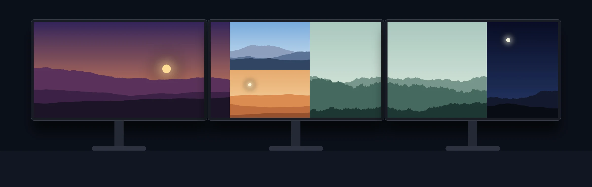

[](https://ko-fi.com/D1D21VSKW5)

# 🎨 WallCraft Pro - Multi-Monitor Wallpaper Generator

🌍 **[English](README_en.md)** | **[Français](README.md)** | **[Español](README_es.md)** | **[Deutsch](README_de.md)**

**WallCraft Pro** est une application Windows en **C# et WinUI 3** pour composer, organiser et appliquer des fonds d’écran sur plusieurs moniteurs. Le mode Taille réelle aligne un panorama même entre des écrans de tailles et de résolutions différentes.

## 🚀 Fonctionnalités Clés

### 🖥️ Gestion Multi-Écrans Avancée
- **Détection automatique** de la disposition physique de vos écrans (gauche/droite, hauteur).
- **Application native** : Applique un fond d'écran différent par moniteur (via l'API Windows `IDesktopWallpaper`).
- **Mode Secours** : Bascule en mode "Panorama" (Span) si l'API n'est pas supportée.
- **Taille réelle des écrans** (menu *Écrans*) : chaque écran est placé selon sa taille physique (lue dans l'EDID, modifiable) et l'espace entre les dalles ; une ligne d'horizon reste droite entre un 27″ et un 24″.
- **Fond automatique** : un fond mémorisé par configuration d'écrans, réappliqué quand les écrans changent (station d'accueil) ou quand Windows remet un thème ; rotation d'images depuis un dossier ; icône dans la zone de notification et lancement au démarrage.

### 📐 Le Moteur de Visibilité Absolue (Fit Inside)
Le programme garantit la règle du 100% :
- **0 Rognage (Crop)** : en mode *Ajuster*, les modes automatiques ne coupent jamais les bords d'une image ; le rognage reste un choix manuel (mode *Rogner*).
- **0 Superposition** : Aucune photo ne couvre une autre photo.
- **0 Dépassement** : Les images ne déborderont jamais de l'écran.
- **0 Déformation** : Le ratio original est mathématiquement préservé.
- **Mode Remplir (au choix)** : couvre tous les écrans ; chaque photo est recadrée autour des visages détectés (OpenCV), sinon autour de sa zone la plus détaillée. Jamais de déformation.

### 🧩 6 Algorithmes d'Organisation (Auto-Layout)
- ⭐ **Optimisation Maximale** : recherche sur des arbres de découpage binaires, avec un nombre d'essais et une graine fixes : mêmes images, même résultat. Le bouton *Variantes…* propose 4 dispositions côte à côte. Heuristique : pas de garantie d'optimum global.
- **Mosaïque Parfaite** : Un arrangement aléatoire de type patchwork (technique BSP).
- **Lignes Justifiées** : Alignement type Flickr/Google Images.
- **Grille Régulière** : Quadrillage mathématique et étendu.
- **Bandes Verticales** et **Bandes Horizontales** : Découpage panoramique pleine hauteur ou largeur.



### ⚡ Performance & Édition
- **Système de Proxy** : Utilise des miniatures pour une interface plus réactive grâce à des miniatures de 1 024 pixels maximum.
- **Retouche Intégrée** : Luminosité, Contraste, Saturation, Flou et Rotation.
- **Rendu HD** : L'export final utilise les fichiers Ultra HD originaux pour préserver la résolution disponible.

## Prérequis et installation

- **Utilisation**. Windows x64. Windows 11 est recommandé. Le paquet déclare Windows 10 version 2004 (build 19041) comme minimum technique.
- **Compilation**. Windows x64, SDK .NET 10 et accès à NuGet pour restaurer le Windows App SDK et les autres dépendances.

Le paquet MSIX et la compilation autonome incluent les runtimes .NET et Windows App SDK. Python intervient uniquement dans certains scripts du dépôt.

## Obtenir WallCraft Pro

- Le paquet MSIX est destiné au Microsoft Store. Le [guide Microsoft Store](docs/MICROSOFT_STORE.md) couvre sa préparation et la soumission.
- Pour essayer le build C# de développement, téléchargez `WallCraft-win-x64` depuis une exécution réussie du [workflow C#](https://github.com/rangornrar/MultiScreenWallpaper/actions/workflows/csharp.yml). Extrayez toute l’archive dans un dossier et ouvrez `WallCraft.exe`.

### Compiler depuis les sources

```powershell
dotnet publish csharp/src/WallCraft.App -c Release -r win-x64 -p:Platform=x64 --self-contained true -p:PublishSingleFile=true -o publish/win-x64
```

Lancez `publish/win-x64/WallCraft.exe`. Conservez les fichiers de ce dossier avec l’exécutable.

## 🛠️ Utilisation

1. Lancez **WallCraft Pro** depuis le menu Démarrer après installation, ou ouvrez `WallCraft.exe` depuis le dossier de compilation.
3. **Langue** : choisissez EN/FR/ES/DE directement depuis l'interface.
4. **Choisir une disposition** : sélectionnez l'un des 6 modes (« Optimisation Maximale » recommandé pour limiter les bandes noires).
5. **Auto-Organiser**, puis ajustez à la main : modes *Déplacer*, *Redimensionner* et *Rogner*, calques avant/arrière, *Pivoter 90°* et *Retouches…* (luminosité, contraste, saturation, flou).
6. **Menu Fichier** :
    * Enregistrer / ouvrir un projet (`Ctrl+S` / `Ctrl+O`).
    * Exporter l'image complète (`Ctrl+E`) ou une image par écran.
    * 🖥️ Appliquer en fond : modifie votre bureau Windows, écran par écran.

## 📂 Organisation du dépôt

| Dossier | Contenu |
|---|---|
| `csharp/` | Application WinUI 3, moteur de composition et intégration Windows |
| `python/` | Ancienne implémentation Python/Tkinter, conservée pour les références de migration |
| `site/` | Générateur, ressources et pages du site |
| `docs/` | Architecture, tests et publication |
| `tools/` | Scripts pour le site, les traductions et les données de référence |

## 🐛 Dépannage

- **Bandes noires en mode Ajuster**. Le mode conserve les photos entières. Utilisez *Remplir* pour couvrir les écrans avec recadrage.
- **Export complet trop large**. Choisissez l’export par écran si la composition dépasse la limite de texture du GPU.

## 📄 Licence

Distribué sous licence [MIT](LICENSE).

## Architecture et validation

[Architecture](docs/ARCHITECTURE.md) · [Tests et validation](docs/QUALITY.md) · [Migration et compatibilité](docs/MIGRATION_CSHARP.md).
