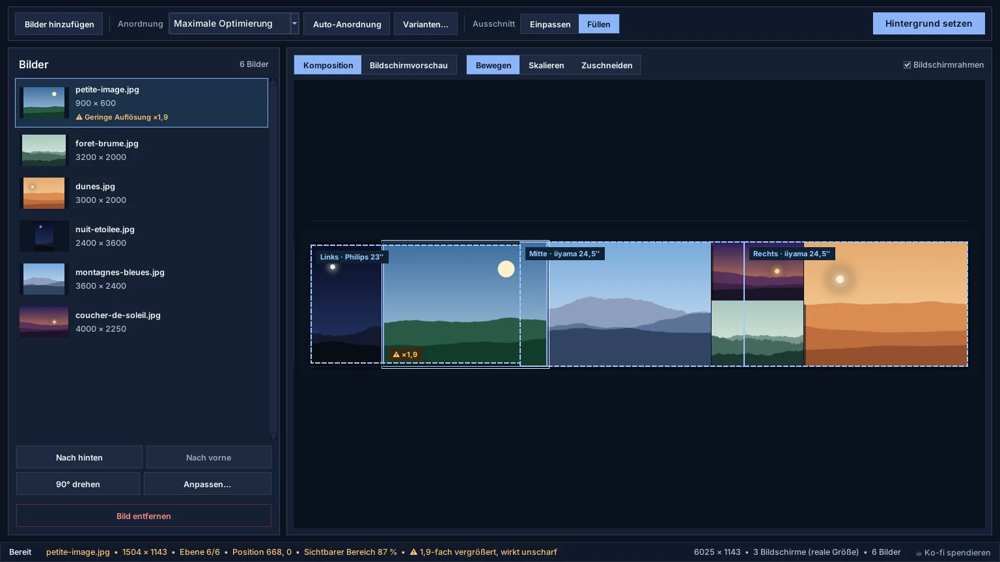
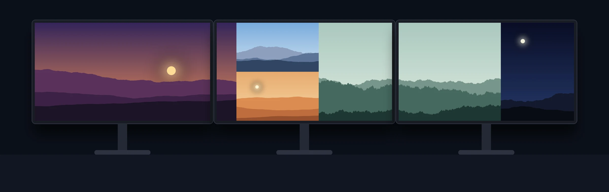

[](https://ko-fi.com/D1D21VSKW5)

# 🎨 WallCraft Pro - Multi-Monitor-Hintergrundbild-Generator

🌍 **[English](README_en.md)** | **[Français](README.md)** | **[Español](README_es.md)** | **[Deutsch](README_de.md)**

**WallCraft Pro** erstellt, organisiert und setzt Hintergrundbilder für mehrere Windows-Monitore. Die Version mit C# und WinUI 3 ist für den Microsoft Store vorgesehen. GitHub Releases stellt die Python-Version bereit.

Sie löst das Problem unterschiedlicher Monitorauflösungen und Bildschirmränder durch ihre intelligente Engine vollständig: Sie ermöglicht das Zusammenfügen mehrerer Fotos, **ohne diese jemals zu verzerren oder zuzuschneiden**, und garantiert so eine **absolute 100%ige Sichtbarkeit** Ihrer Bilder ("Fit Inside"-Prinzip).



---

## 🚀 Hauptfunktionen

### 🖥️ Erweitertes Multi-Monitor-Management
- **Automatische Erkennung** der physischen Anordnung Ihrer Bildschirme (links/rechts, Höhe).
- **Native Implementierung**: Setzt pro Monitor ein anderes Hintergrundbild (über die Windows `IDesktopWallpaper`-API).
- **Fallback-Modus**: Wechselt automatisch in den "Panorama"-Modus (Span), falls die native API nicht unterstützt wird.
- **Reale Bildschirmgröße** (Menü *Bildschirme*): Jeder Bildschirm wird nach seiner physischen Größe (aus der EDID, anpassbar) und dem Abstand zwischen den Panels platziert; ein Horizont bleibt zwischen einem 27″- und einem 24″-Monitor gerade.
- **Automatisches Hintergrundbild**: ein gespeichertes Hintergrundbild pro Bildschirmkonfiguration, erneut angewendet, wenn sich die Bildschirme ändern (Dockingstation) oder Windows ein Design wiederherstellt; Bildwechsel aus einem Ordner; Symbol im Infobereich und Start mit Windows.

### 📐 Die Absolute "Fit Inside" Engine
Das Programm hält sich strikt an die 100 % Regel:
- **0 Zuschnitt (Crop)**: Im Modus *Einpassen* schneiden die automatischen Layouts nie Bildränder ab; Zuschneiden ist eine manuelle Entscheidung (Modus *Zuschneiden*).
- **0 Überlappung**: Kein Foto verdeckt ein anderes Foto.
- **0 Überstand**: Bilder ragen niemals über die Bildschirmränder hinaus.
- **0 Verzerrung**: Das ursprüngliche Seitenverhältnis bleibt mathematisch gewahrt.
- **Modus Füllen (optional)**: bedeckt alle Bildschirme; jedes Foto wird um erkannte Gesichter (OpenCV) zugeschnitten, sonst um seinen detailreichsten Bereich. Nie verzerrt.

### 🧩 6 Layout-Algorithmen (Auto-Layout)
- ⭐ **Maximale Optimierung**: Suche über binäre Slicing-Floorplan-Bäume mit fester Anzahl an Versuchen und festem Startwert: gleiche Bilder, gleiches Ergebnis. Die Schaltfläche *Varianten…* zeigt 4 Layouts nebeneinander. Heuristik: kein garantiertes globales Optimum.
- **Perfektes Mosaik**: Eine randomisierte Patchwork-Anordnung (BSP-Technik).
- **Ausgerichtete Linien**: Ausrichtung ähnlich wie bei Flickr/Google Bilder.
- **Regelmäßiges Raster**: Ein mathematisch gleichmäßiges Raster.
- **Vertikale & Horizontale Streifen**: Panorama-Slicing über die volle Höhe oder volle Breite.



### ⚡ Leistung & Bearbeitung
- **Proxy-System**: Verwendet Miniaturansichten für eine extrem flüssige Benutzeroberfläche, selbst bei 8K-Bildern.
- **Integrierte Bildbearbeitung**: Helligkeit, Kontrast, Sättigung, Unschärfe und Drehung.
- **HD-Rendering**: Der endgültige Export verwendet die originalen Ultra-HD-Dateien für absolut maximale Qualität.

---

## 📦 Python-Version aus dem Quellcode starten

### Voraussetzungen
- Python 3.10 oder höher.
- Windows 10/11 (Erforderlich aufgrund der Windows-Wallpaper-API).

### Abhängigkeiten
```bash
cd python
pip install pillow screeninfo
```

## 📥 Download

Die [Anleitung für den Microsoft Store](docs/MICROSOFT_STORE.md) beschreibt, wie das C#-MSIX erstellt und vorbereitet wird.

Die Windows-EXE wird auf der Seite [GitHub Releases](https://github.com/rangornrar/MultiScreenWallpaper/releases/latest) veröffentlicht. Ihre SHA-256-Prüfsumme steht in den Notizen jeder Version.

## 🛠️ Verwendung
1. Starten Sie die App: `python main.py` (im Ordner `python/`) (oder die EXE aus der [neuesten Release](https://github.com/rangornrar/MultiScreenWallpaper/releases/latest)).
2. **Bilder hinzufügen**: Schaltfläche „+ Bilder hinzufügen“ oder Menü *Datei*. Smartphone-Fotos werden automatisch richtig gedreht.
3. **Sprache**: Wählen Sie EN/FR/ES/DE direkt in der Oberfläche.
4. **Layout wählen**: Wählen Sie einen der 6 Modi („Maximale Optimierung“ empfohlen, um schwarze Balken zu minimieren).
5. **Auto-Anordnen**, dann von Hand verfeinern: Modi *Bewegen*, *Skalieren* und *Zuschneiden*, Ebenen vor/zurück, *90° drehen* und *Anpassen…* (Helligkeit, Kontrast, Sättigung, Unschärfe).
6. **Menü Datei**:
    * Projekt speichern / öffnen (`Strg+S` / `Strg+O`).
    * Gesamtbild exportieren (`Strg+E`) oder ein Bild pro Bildschirm.
    * 🖥️ Hintergrundbild anwenden: ändert Ihren Windows-Desktop, Bildschirm für Bildschirm.

## 📂 Aufbau des Repositorys
| Ordner | Inhalt |
|---|---|
| `python/` | Version auf GitHub Releases (Python/Tkinter), Tests und PyInstaller-Rezept |
| `csharp/` | Microsoft-Store-Version (C# / WinUI 3), siehe [docs/MIGRATION_CSHARP.md](docs/MIGRATION_CSHARP.md) |
| `site/` | Generator der Website wallcraft.archi-it.fr (`site_builder.py`), Screenshots (`assets/`) und die fertige Website (`html/`) |
| `docs/` | Architektur, Qualität, Migration, Veröffentlichung |
| `tools/` | Skripte: Referenzergebnisse für die C#-Version, Übersetzungen, Mockups |

### Python-Version (`python/`)
* `main.py`: Einstiegspunkt, koppelt Windows High-DPI-Einstellungen.
* `ui.py`: Fenster, interaktive Arbeitsfläche, Menüs.
* `locales.py`: Mehrsprachiges Register.
* `image_tools.py`: Kerngeschäftslogik. Tiefe Bildmanipulation und Layout-Engine (`AutoLayoutStrategy`).
* `screen_splitter.py`: `ctypes` Systemaufrufe für die native Windows-Verknüpfung.

## 🐛 Fehlerbehebung
* **Ist die Anwendung unscharf?** Führen Sie sie über das Standard-Terminal von Windows (cmd/powershell) und nicht über eine Entwicklungsumgebung (IDE) aus. 
* **Sind schwarze Balken sichtbar?** Im Modus *Einpassen* ist das erwartet: kein Bild wird zugeschnitten, der restliche Platz bleibt schwarz. Wählen Sie *Füllen*, um die Bildschirme zu bedecken, oder „Maximale Optimierung“, um die Balken zu verringern.


## 📄 Lizenz
Veröffentlicht unter der [MIT-Lizenz](LICENSE).

## Architecture & validation

[Architecture and trade-offs](docs/ARCHITECTURE.md) · [Quality and test scope](docs/QUALITY.md).
