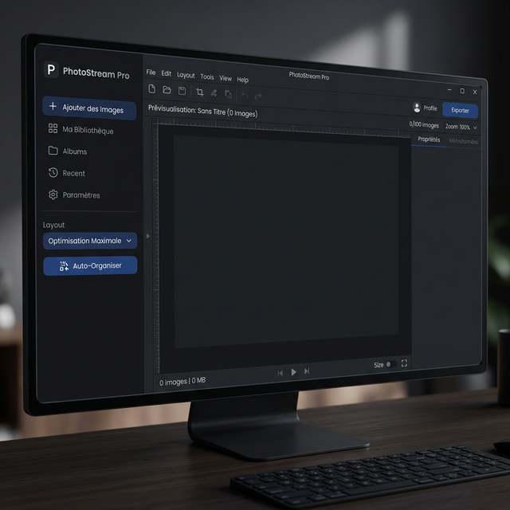
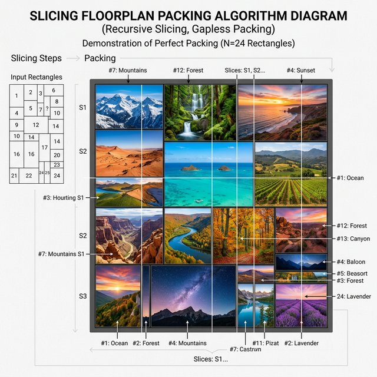

[](https://ko-fi.com/D1D21VSKW5)

# 🎨 WallCraft Pro - Multi-Monitor Wallpaper Generator

🌍 **[English](README_en.md)** | **[Français](README.md)** | **[Español](README_es.md)** | **[Deutsch](README_de.md)**

**WallCraft Pro** is a powerful Python application designed to create, organize, and apply wallpapers across complex multi-monitor setups.

It completely solves the issue of disparate monitor resolutions and borders through its intelligent engine: it merges multiple photos **without ever distorting or cropping them**, guaranteeing **100% absolute visibility** of your images ("Fit Inside" principle).



---

## 🚀 Key Features

### 🖥️ Advanced Multi-Monitor Management
- **Automatic detection** of your screens' physical layout (left/right, height).
- **Native Implementation**: Applies a different wallpaper per monitor (via the Windows `IDesktopWallpaper` API).
- **Fallback Mode**: Automatically switches to "Span" mode if the API is unsupported.
- **Real screen size** (*Screens* menu): each screen is placed by its physical size (read from EDID, editable) and the gap between panels, so a horizon stays straight across a 27″ and a 24″ display.
- **Automatic wallpaper**: one wallpaper remembered per screen setup, reapplied when screens change (docking) or when Windows restores a theme; image rotation from a folder; notification-area icon and start with Windows.

### 📐 The Absolute Visibility Engine (Fit Inside)
The program adheres to the 100% rule:
- **0 Cropping**: in *Fit* mode, automatic layouts never cut an image's edges; cropping is a manual choice (*Crop* mode).
- **0 Overlap**: No photo covers another photo.
- **0 Overflow**: Images will never spill off the screen edges.
- **0 Distortion**: The original aspect ratio is mathematically preserved.
- **Fill mode (optional)**: covers every screen; each photo is cropped around detected faces (OpenCV), otherwise around its most detailed area. Never distorted.

### 🧩 6 Layout Algorithms (Auto-Layout)
- ⭐ **Maximum Optimization**: searches binary slicing-floorplan trees with a fixed number of tries and a fixed seed: same images, same result. The *Variants…* button shows 4 layouts side by side. Heuristic: no guarantee of a global optimum.
- **Perfect Mosaic**: A randomized patchwork arrangement (BSP technique).
- **Justified Lines**: Alignment similar to Flickr/Google Images.
- **Regular Grid**: A mathematically uniform grid.
- **Vertical Strips** & **Horizontal Strips**: Full height or full width panoramic slicing.



### ⚡ Performance & Editing
- **Proxy System**: Uses thumbnails for a hyper-fluid UI even with 8K images.
- **Built-in Editing**: Brightness, Contrast, Saturation, Blur, and Rotation.
- **HD Rendering**: The final export leverages the original Ultra HD files for absolute maximum quality.

---

## 📦 Installation

### Prerequisites
- Python 3.10 or higher.
- Windows 10/11 (Required for the desktop wallpaper API).

### Dependencies
```bash
cd python
pip install pillow screeninfo
```

## 📥 Download
The Windows executable is published on the [GitHub Releases](https://github.com/rangornrar/MultiScreenWallpaper/releases/latest) page. Its SHA-256 checksum is listed in each release's notes.

## 🛠️ Usage
1. Launch the app: `python main.py` (in `python/`) (or the executable from the [latest release](https://github.com/rangornrar/MultiScreenWallpaper/releases/latest)).
2. **Add images**: "+ Add Images" button or the *File* menu. Smartphone photos are automatically turned upright.
3. **Language**: choose EN/FR/ES/DE directly from the UI.
4. **Choose a layout**: select one of the 6 modes ("Maximum Optimization" is recommended to limit black bars).
5. **Auto-Arrange**, then fine-tune by hand: *Move*, *Scale* and *Crop* modes, layer forward/back, *Rotate 90°* and *Adjust…* (brightness, contrast, saturation, blur).
6. **File menu**:
    * Save / open a project (`Ctrl+S` / `Ctrl+O`).
    * Export the full image (`Ctrl+E`) or one image per screen.
    * 🖥️ Apply wallpaper: updates your Windows desktop, screen by screen.

## 📂 Repository layout
| Folder | Contents |
|---|---|
| `python/` | Current app (Python/Tkinter), its tests and the PyInstaller recipe |
| `csharp/` | Upcoming version (C# / WinUI 3), see [docs/MIGRATION_CSHARP.md](docs/MIGRATION_CSHARP.md) |
| `site/` | Website generator for wallcraft.archi-it.fr (`site_builder.py`), screenshots (`assets/`) and the ready-to-publish site (`html/`) |
| `docs/` | Architecture, quality, migration, release process |
| `tools/` | Scripts: reference results for the C# version, translations, mockups |

### Python version (`python/`)
* `main.py`: Entry point, hooks High-DPI Windows settings.
* `ui.py`: Window, interactive canvas, menus and mouse event loop.
* `locales.py`: Multilingual registry string dictionary.
* `image_tools.py`: Core logic. Deep image manipulation and layout engine strategies (`AutoLayoutStrategy`).
* `screen_splitter.py`: `ctypes` system calls for native Windows injection.

## 🐛 Troubleshooting
* **Is the application blurry?** Run it via the standard Windows terminal (cmd/powershell) rather than an IDE terminal to ensure Windows High-DPI handling is engaged.
* **Are black bars visible on the edges?** In *Fit* mode this is expected: no image is cropped, so the remaining space stays black. Choose *Fill* to cover the screens, or "Maximum Optimization" to reduce the bars.


## 📄 License
Released under the [MIT License](LICENSE).

## Architecture & validation

[Architecture and trade-offs](docs/ARCHITECTURE.md) · [Quality and test scope](docs/QUALITY.md).
