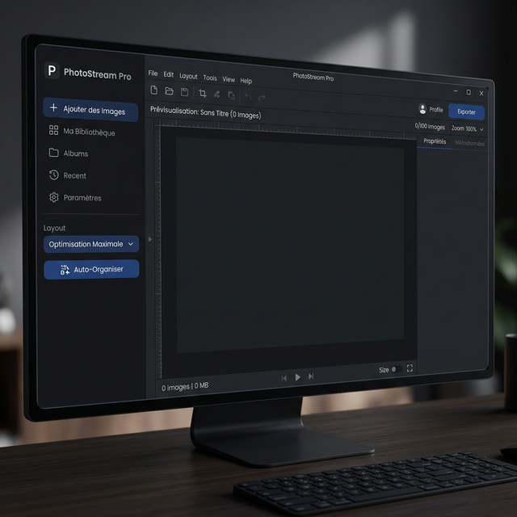
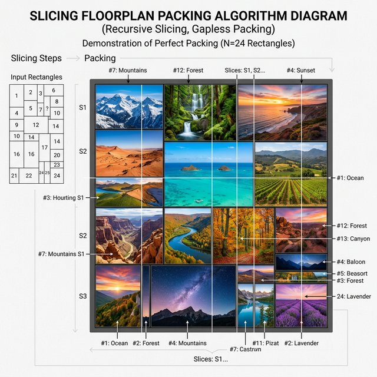

[](https://ko-fi.com/D1D21VSKW5)

# 🎨 WallCraft Pro - Generador de Fondos de Pantalla Multimonitor

🌍 **[English](README_en.md)** | **[Français](README.md)** | **[Español](README_es.md)** | **[Deutsch](README_de.md)**

**WallCraft Pro** es una potente aplicación de Python diseñada para crear, organizar y aplicar fondos de pantalla en configuraciones complejas de múltiples monitores.

Resuelve completamente el problema de las resoluciones de monitores dispares mediante su motor inteligente: permite fusionar múltiples fotos **sin distorsionarlas ni recortarlas nunca**, garantizando una **visibilidad absoluta del 100%** de sus imágenes (principio "Encuadre exacto" / Fit Inside).



---

## 🚀 Características Clave

### 🖥️ Gestión Avanzada Multimonitor
- **Detección automática** de la disposición física de sus pantallas (izquierda/derecha, altura).
- **Implementación Nativa**: Aplica un fondo de pantalla diferente por monitor (a través de la API `IDesktopWallpaper` de Windows).
- **Modo de Respaldo**: Cambia automáticamente al modo "Panorámica" si la API nativa no es compatible.

### 📐 El Motor de Visibilidad Absoluta
El programa se adhiere a la regla del 100%:
- **0 Recortes (Crop)**: los modos automáticos nunca cortan los bordes de una imagen; el recorte es una elección manual (modo *Recortar*).
- **0 Superposición**: Ninguna foto cubre a otra foto.
- **0 Desbordamiento**: Las imágenes nunca superarán los bordes de la pantalla.
- **0 Distorsión**: La relación de aspecto original se conserva matemáticamente.

### 🧩 6 Algoritmos de Disposición (Auto-Layout)
- ⭐ **Optimización Máxima (Lento)**: La joya de la corona. Simula cientos de miles de permutaciones geométricas mediante un árbol binario matemático ("Slicing Floorplan") para anidar sus imágenes sin dejar espacio vacío interno, formando un bloque colosal que estadísticamente reduce las bandas negras a casi cero.
- **Mosaico Perfecto**: Un arreglo aleatorio tipo patchwork (Técnica BSP).
- **Líneas Justificadas**: Alineación similar a Flickr o Google Images.
- **Cuadrícula Regular**: Una cuadrícula matemáticamente uniforme.
- **Bandas Verticales** y **Bandas Horizontales**: Rebanado panorámico de altura o anchura completa.



### ⚡ Rendimiento y Edición
- **Sistema de Proxy**: Utiliza miniaturas para una interfaz de usuario extremadamente fluida incluso con imágenes 8K.
- **Edición Integrada**: Brillo, Contraste, Saturación, Desenfoque y Rotación.
- **Renderizado HD**: La exportación final aprovecha los archivos originales Ultra HD para máxima calidad absoluta.

---

## 📦 Instalación

### Requisitos previos
- Python 3.10 o superior.
- Windows 10/11 (Requerido debido a la API de fondos de pantalla).

### Dependencias
```bash
pip install pillow screeninfo
```

## 📥 Descargar
El ejecutable de Windows se publica en la página [GitHub Releases](https://github.com/rangornrar/MultiScreenWallpaper/releases/latest). Su huella SHA-256 figura en las notas de cada versión.

## 🛠️ Uso
1. Inicie la aplicación: `python main.py` (o el ejecutable de la [última versión](https://github.com/rangornrar/MultiScreenWallpaper/releases/latest)).
2. **Añadir imágenes**: botón «+ Añadir Imágenes» o menú *Archivo*. Las fotos de smartphone se enderezan automáticamente.
3. **Idioma**: elija EN/FR/ES/DE directamente desde la interfaz.
4. **Elija una disposición**: seleccione uno de los 6 modos («Optimización Máxima» recomendada para limitar las bandas negras).
5. **Auto-Organizar** y luego ajuste a mano: modos *Mover*, *Escalar* y *Recortar*, capas adelante/atrás, *Girar 90°* y *Ajustes…* (brillo, contraste, saturación, desenfoque).
6. **Menú Archivo**:
    * Guardar / abrir un proyecto (`Ctrl+S` / `Ctrl+O`).
    * Exportar la imagen completa (`Ctrl+E`) o una imagen por pantalla.
    * 🖥️ Aplicar fondo: modifica su escritorio de Windows, pantalla por pantalla.

## 📂 Estructura del Proyecto
* `main.py`: Punto de entrada, gestiona el High-DPI de Windows.
* `ui.py`: Ventana, lienzo interactivo y bucle de eventos.
* `locales.py`: Diccionario multilingüe de cadenas.
* `image_tools.py`: Lógica principal, matemáticas y diseño.
* `screen_splitter.py`: Llamadas `ctypes` a Windows.

## 🐛 Solución de Problemas
* **¿La aplicación se ve borrosa?** Ejecútela a través de la terminal estándar (cmd/powershell) en lugar de la IDE para garantizar que Windows utilice la alta fidelidad visual nativa.
* **¿Bordos o bandas negras muy prominentes?** Al no recortar NINGUNA imagen, el espacio restante debe ser llenado. Use "Optimización Máxima" para forzar mejores encajes de rompecabezas.


## 📄 Licencia
Distribuido bajo la [licencia MIT](LICENSE).

## Architecture & validation

[Architecture and trade-offs](docs/ARCHITECTURE.md) · [Quality and test scope](docs/QUALITY.md).
